## the user story

:::::::::::: {.columns}
::::::::: {.column width="65%" .text-smaller}

::: {.wide-quote}
> We would like you to create a flashcard app for smartphones.
> Just the [**usual stuff**]{.background-color-lightblue}: it shows cards and then if needed it shows the other side of the card with the meaning.
>
> Oh, and words should be in [**groups**]{.background-color-lightblue}. A [**word can appear in multiple groups**]{.background-color-lightblue}.
> The user [**selects a group**]{.background-color-lightblue} to practice. Then, the app shows a card with the word (or expression) in the target language.
> The user can do 3 things:
>
> 1. Tap the card to show its other side, both sides should be shown at the same time,
> 2. The user can swipe left to indicate that they do not know the word, or
> 3. swipe to right indicating the they know the word well.
>
> The app should [**count the swipes and keep statistics**]{.background-color-lightblue}.
> And one more thing: the [**statistics should be tracked per user basis**]{.background-color-lightblue}.

:::
:::::::::
::::::::: {.column width="35%"}
requirement smells

: language based signs in the requirements that indicate issues

misunderstanding the task can be costly

: ![[decreasing probability of introducing defects [@ambler2002agile]]{.text-smaller}](figures/introducing_defects.drawio.svg){data-preview-image="figures/introducing_defects.drawio.svg" data-preview-fit="contain"}

:::::::::
::::::::::::

::: {.mt-1}
requirement smell | review with output | documentation
:::


# requirement analysis

:::::::::::: {.columns}
::::::::: {.column width="65%" .text-smaller}

:::::::::
::::::::: {.column width="35%"}

**user story**

as a \<language learner><br>
I want to \<see my stats><br>
in order to \<track my progress>

::: {.mt-2}
the USM uses the user’s perspective to tell a story / narrative

overview first, zoom into details later
:::
:::::::::
::::::::::::

::: {.mt-1}
<!-- user story mapping | review with output | documentation -->
:::


## steps of requirement analysis

1. stakeholder identification
2. elicitation of requirements (gathering data)
3. documentation of requirements
4. analysis and negotiation
5. validation and verification
        
:::::::::::: {.columns .text-smaller .mt-3}
::::::::: {.column width="50%"}
validation

:    - are we building the right thing?
:    - is about confirming that the requirements actually meet the needs of the stakeholders

:::::::::
::::::::: {.column width="50%"}
verification

:    - are we building the thing right?
:    - to ensure that all requirements are clear, unambiguous, and consistent

:::::::::
::::::::::::


## functional and non-functional requirements

::: {.wide-quote}
functional requirements define what a system is supposed to do<br>and non-functional requirements define how a system is supposed to operate [@enwiki:1245895117]

:::

:::::::::::: {.columns .mt-3}
::::::::: {.column width="50%"}
functional

- [what]{.background-color-lightblue}
- features
- the webserver can serve pages via HTTP2

:::::::::
::::::::: {.column width="50%}
non-functional

- [how]{.background-color-lightblue}
- quality goals, quality of service requirements
- webserver is available 99.9% of time<br>(yearly about 8h 41m downtime)
- can serve at least 5.000 queries per sec

:::::::::
::::::::::::


## minimum viable product

:::::::::::::::::: {.columns}
::::::::::::::: {.column width="60%"}

:::::::::::: {.columns}
::::::::: {.column width="30%"}
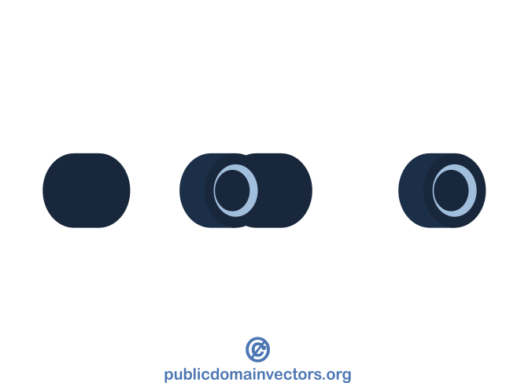{height=150}

:::::::::
::::::::: {.column width="30%"}
{height=150}

:::::::::
::::::::: {.column width="30%"}
{height=150}

:::::::::
::::::::::::

:::::::::::: {.columns}
::::::::: {.column width="30%"}
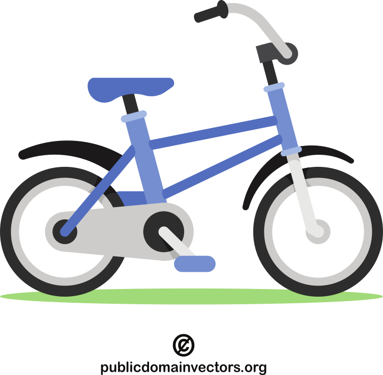{height=150}

:::::::::
::::::::: {.column width="30%"}
{height=150}

:::::::::
::::::::: {.column width="30%"}
{height=150}

:::::::::
::::::::::::

::: {.text-smaller}
based on [Making sense of MVP (Minimum Viable Product)](https://blog.crisp.se/2016/01/25/henrikkniberg/making-sense-of-mvp) by Henrik Kniberg
:::

:::::::::::::::
::::::::::::::: {.column width="40%"}
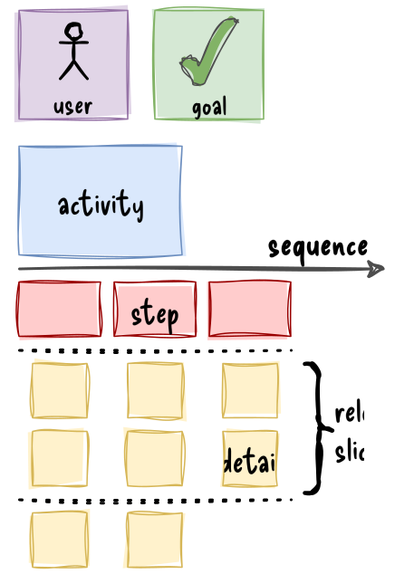
:::::::::::::::
::::::::::::::::::

::: {.text-smaller}
Gall's law: _A complex system that works is invariably evolved from a simple system that worked._

:::


# wireframing

:::::::::::: {.columns}
::::::::: {.column width="40%" .text-smaller .mt-2}
`as a user I want to see my activity to track my progress`

display user statistics including

:    - username
     - profile image
     - registration date
     - progress in course
     - last mondth activity

:::::::::
<!--
::::::::: {.column width="30%"}
{width=242}

:::::::::
::::::::: {.column width="30%"}
{width=250}
:::::::::
-->
::::::::: {.column width="60%"}
:::::: {.r-stack}
::: {.fragment .fade-out fragment-index=1}
{width=242}
{width=250}
:::
::: {.fragment .fade-in fragment-index=1}
{width=250}
{width=250}
:::
::::::
:::::::::
::::::::::::


## wireframe map

{width=750}


# design

offline application, a simple case

:::::: {.r-stack}
::: {.fragment .fade-out data-fragment-index=1}
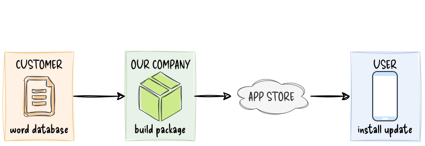{width=550}
:::
::: {.fragment .fade-in data-fragment-index=1}
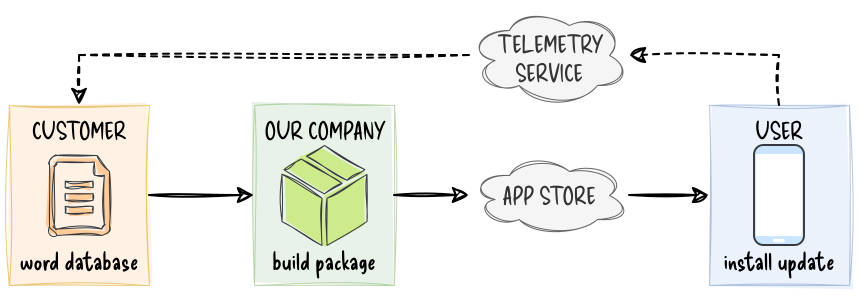{width=550}
:::
::::::

:::::: {.r-stack}
::: {.fragment .fade-out data-fragment-index=1}

:::
::: {.fragment .fade-in data-fragment-index=1}

:::
::::::


## system context diagram

:::::::::::: {.columns}
::::::::: {.column width="60%" .mt-2}
- shows how the software fits into the world
  - [who use it]{.text-smaller}
  - [what other software does it interacts]{.text-smaller}
- high level diagram
  - [technologies, protocols and other low-level details are not important]{.text-smaller}
- similar to use case diagram
- understandable for non-technical people

:::::::::
::::::::: {.column width="40%"}
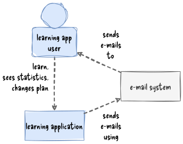{width=400}

::: {.text-smaller}
other possible users:

administrator, course planner
:::
:::::::::
::::::::::::


## system context vs use case

:::::::::::: {.columns}
::::::::: {.column width="50%" }


:::::::::
::::::::: {.column width="50%"}
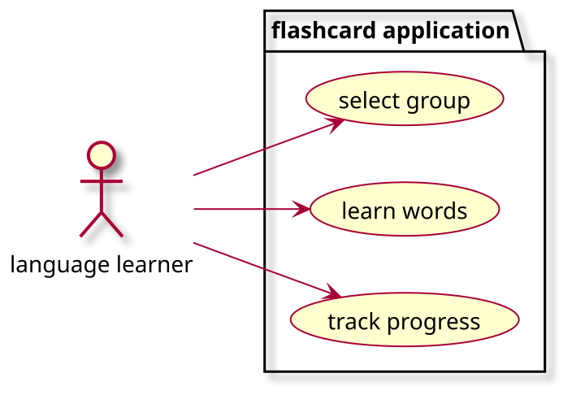

:::::::::
::::::::::::


## container - SaaS variant

:::::::::::: {.columns}
::::::::: {.column width="50%" .mt-2}
- zooms into the software system
- shows the containers that make up that software system
  - [applications, data stores, microservices]{.text-smaller}
- technology decisions are also a key part of this diagram
  - [what DBMS to use]{.text-smaller}
  - [what e-mail service to use]{.text-smaller}
  - [what programming language to use]{.text-smaller}
  - [what UI framework to use]{.text-smaller}

:::::::::
::::::::: {.column width="50%"}

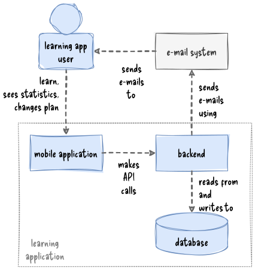{width=375}
:::::::::
::::::::::::


## container

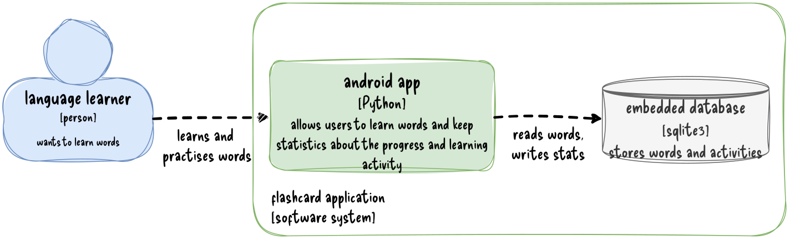

## component diagram

:::::::::::: {.columns}
::::::::: {.column width="60%"}
- decomposition of each container to identify the major structural building blocks and their interactions
- shows how a container is made up of a number of "components" 
  - what these components are, 
  - what they are responsibilities for, and
  - what also shows technology / implementation details
- roughly equivalent with the UML component diagram

:::::::::
::::::::: {.column width="40%"}
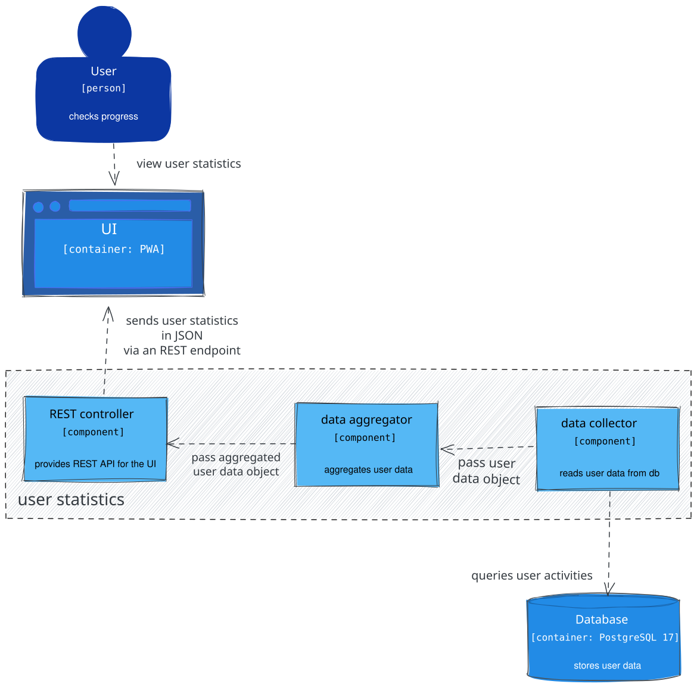{width=400}

:::::::::
::::::::::::


## component - GUI focus



# architectural styles / topologies

:::::::::::: {.columns}
::::::::: {.column width="33%"}
control flow? structure?

![[historically grown architecture<br>based on [@woltmann2023hexagonal]]{.text-smaller}](figures/legacy_structure.drawio.svg){width=400 data-preview-image="figures/legacy_structure.drawio.svg" data-preview-fit="contain"}

:::::::::
::::::::: {.column width="33%"}
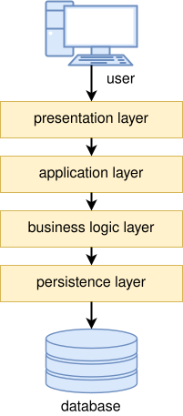{width=200}

:::::::::
::::::::: {.column width="33%"}
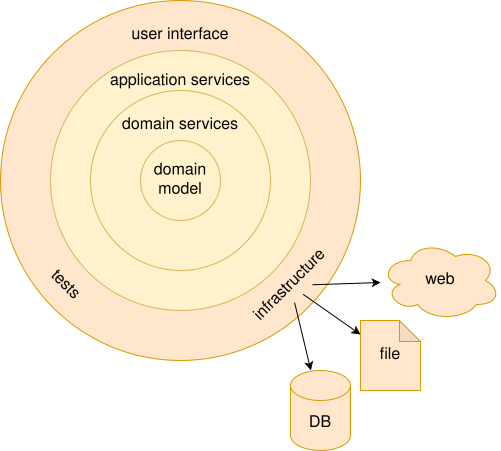{width=250}

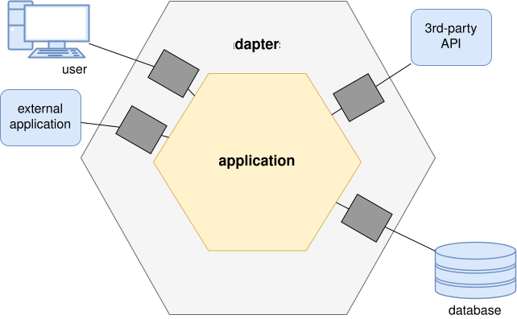{width=250}

:::::::::
::::::::::::

##

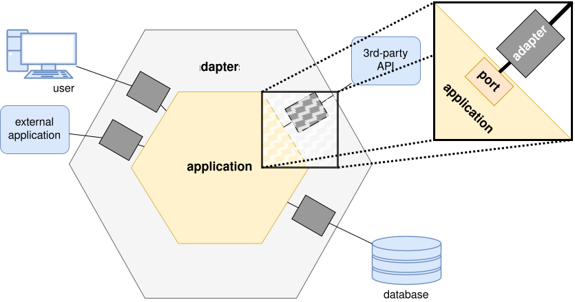{width=700}

the most important elements of the design are the interfaces, hexagonal architecture focuses on them

## user statistics - C4 component

:::::::::::: {.columns}
::::::::: {.column width="60%"}
:::::: {.r-stack}
::: {.absolute-left data-left="250"}
focus on the interface<br>between the UI and<br>the user statistics module
:::

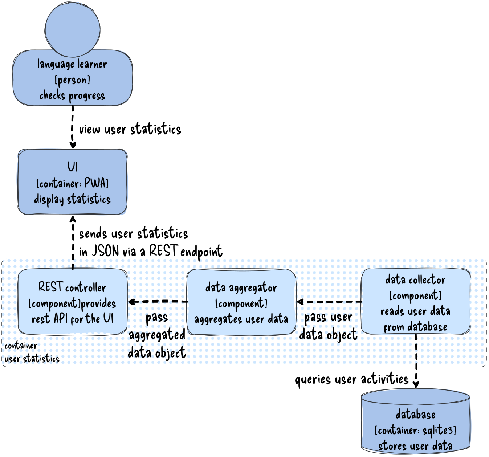
::::::
:::::::::
::::::::: {.column width="40%" .wide-quote}
*sends user statistics in JSON via a REST endpoint*

::: {.mt-3}
- what is in the JSON?
- which endpoint?
:::

::: {.mt-3}
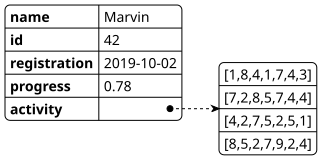

`/user/<id>/statistics`
:::
:::::::::
::::::::::::


## do not change the interface without notice

:::::::::::: {.columns .mt-4}
::::::::: {.column width="50%" }
{width=375}

:::::::::
::::::::: {.column width="50%" }
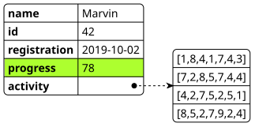{width=375}

:::::::::
::::::::::::

::: {.mt-4}
this will break the frontend

::: {.text-smaller}
it is not just rude, but will waste the time of the other team (with pointless debugging)
:::
:::


## API versions

:::::::::::: {.columns .column-gapless}
::::::::: {.column width="60%"}
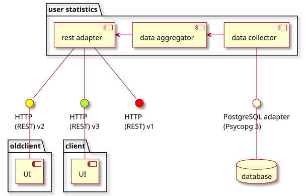{width=475}

:::::::::
::::::::: {.column width="40%"}
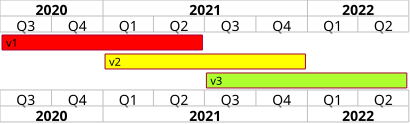{width=375}

::: {.text-smaller}
- 2021-06-30: API v1's end of live
    - service does not accept connections via APIv1
    - code can be removed (no need to maintain it anymore)

:::
:::::::::
::::::::::::

::: {}
`https://developers.facebook.com/v21.0/me?fields=id,name`
:::

## Hyrum's Law

:::::::::::: {.columns}
::::::::: {.column width="65%" .wide-quote .mt-5}
> With a sufficient number of users of an API,
> it does not matter what you promise in the contract:
> all observable behaviors of your system
> will be depended on by somebody.
>
> --  Hyrum Wright, 2012

:::{}
[Hyrum's Law](https://www.hyrumslaw.com/)
:::

:::::::::
::::::::: {.column width="35%"}
no documented `/users` endpoint, but existing implementation

```ruby
get '/users' do
  data = {ids: [42]}
  return data.to_json()
end
```

sooner or later someone will discover the undocumented behavior and depend on it

:::::::::
::::::::::::

::: {.text-smaller}
think like a villian, someone who's going to abuse the system that you’re designing and building

:::


## Postel's law / robustness principle

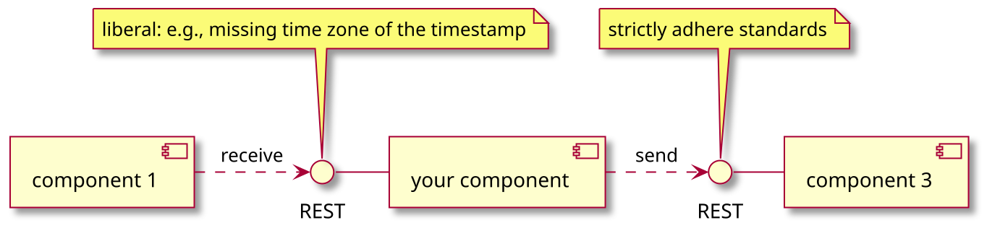

:::::::::::: {.columns .wide-quote}
::::::::: {.column width="33%"}
> When receiving data, handle variations, minor errors, or deviations where possible. Don’t crash or reject communication over minor issues.

:::::::::
::::::::: {.column width="33%"}
> When your system emits data or interacts with the outside world, adhere closely to protocols and standards.

:::::::::
::::::::: {.column width="33%"}
> In modern times, overly liberal acceptance can sometimes mask errors, so this law is occasionally tempered with security considerations.

:::::::::
::::::::::::

:::{.text-smaller}
source: [Laws of Software Engineering / Postel's Law](https://lawsofsoftwareengineering.com/laws/postels-law/) by Dr. Milan Milanović
:::


# architecture review

:::::::::::: {.columns}
::::::::: {.column width="40%"}
{width=400}

:::::::::
::::::::: {.column width="15%" .mt-5}
{width=100}

:::::::::
::::::::: {.column width="40%"}
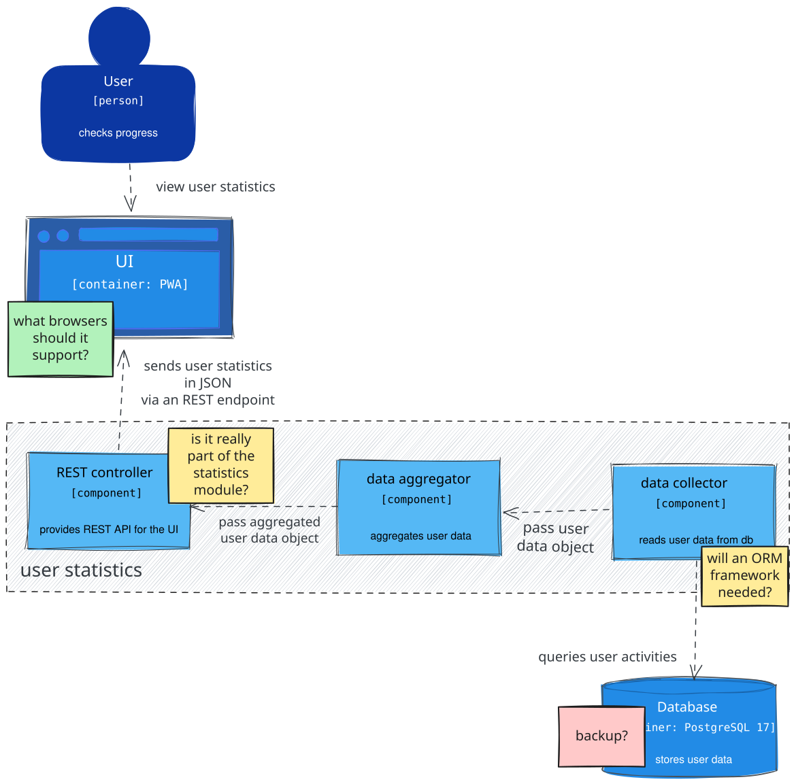{width=400}

:::::::::
::::::::::::

::: {.mt-2}
documenting findings | evaluating them | risk register | mitigation
:::


# references

::: {#refs}
:::


<!--
:::::::::::: {.columns}
::::::::: {.column width="50%" }

:::::::::
::::::::: {.column width="50%"}

:::::::::
::::::::::::
-->
