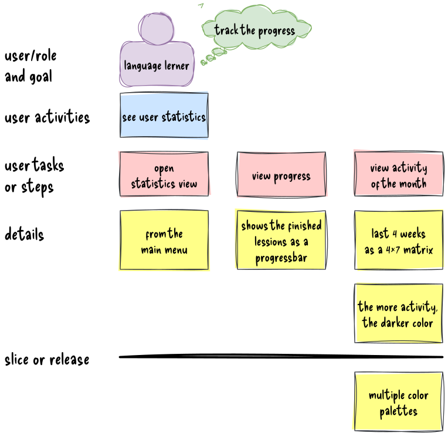
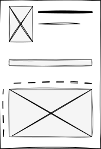
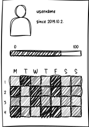
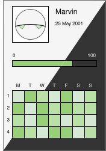
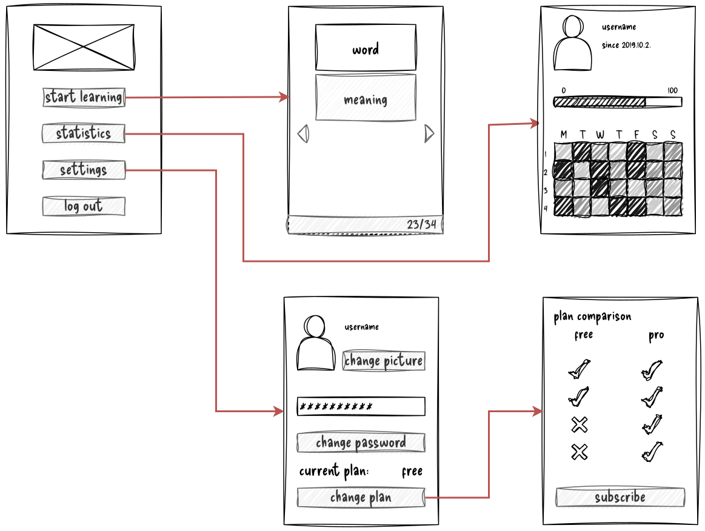

## the user story

:::::::::::: {.columns}
::::::::: {.column width="65%" .text-smaller}

::: {.wide-quote}
> We would like you to create a flashcard app for smartphones.
> Just the [**usual stuff**]{.background-color-lightblue}: it shows cards and then if needed it shows the other side of the card with the meaning.
>
> Oh, and words should be in [**groups**]{.background-color-lightblue}. A [**word can appear in multiple groups**]{.background-color-lightblue}.
> The user [**selects a group**]{.background-color-lightblue} to practice. Then, the app shows a card with the word (or expression) in the target language.
> The user can do 3 things:
>
> 1. Tap the card to show its other side, both sides should be shown at the same time,
> 2. The user can swipe left to indicate that they do not know the word, or
> 3. swipe to right indicating the they know the word well.
>
> The app should [**count the swipes and keep statistics**]{.background-color-lightblue}.
> And one more thing: the [**statistics should be tracked per user basis**]{.background-color-lightblue}.

:::
:::::::::
::::::::: {.column width="35%"}
requirement smells

: language based signs in the requirements that indicate issues

misunderstanding the task can be costly

: ![[decreasing probability of introducing defects [@ambler2002agile]]{.text-smaller}](figures/introducing_defects.drawio.svg){data-preview-image="figures/introducing_defects.drawio.svg" data-preview-fit="contain"}

:::::::::
::::::::::::

::: {.mt-1}
requirement smell | review with output | documentation
:::

# requirement analysis

:::::::::::: {.columns}
::::::::: {.column width="65%" .text-smaller}

:::::::::
::::::::: {.column width="35%"}

**user story**

as a \<language learner> 
I want to \<see my stats> 
in order to \<track my progress>

::: {.mt-2}
the USM uses the user’s perspective to tell a story / narrative

overview first, zoom into details later
:::
:::::::::
::::::::::::

::: {.mt-1}
<!-- user story mapping | review with output | documentation -->
:::

# wireframing

:::::::::::: {.columns}
::::::::: {.column width="40%" .text-smaller .mt-2}
`as a user I want to see my activity to see my progress`

display user statistics including

:    - username
     - profile image
     - registration date
     - progress in course
     - last mondth activity

:::::::::
<!--
::::::::: {.column width="30%"}
{width=242}

:::::::::
::::::::: {.column width="30%"}
{width=250}
:::::::::
-->
::::::::: {.column width="60%"}
:::::: {.r-stack}
::: {.fragment .fade-out fragment-index=1}
{width=242}
{width=250}
:::
::: {.fragment .fade-in fragment-index=1}
{width=250}
{width=250}
:::
::::::
:::::::::
::::::::::::

## wireframe map

{width=750}

# references

::: {#refs}
:::

<!--:::::::::::: {.columns}
::::::::: {.column width="50%" }

:::::::::
::::::::: {.column width="50%"}

:::::::::
::::::::::::-->
