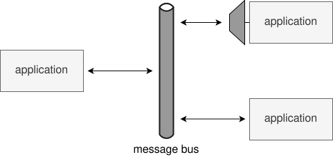
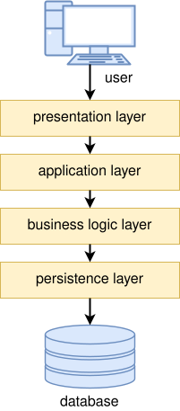
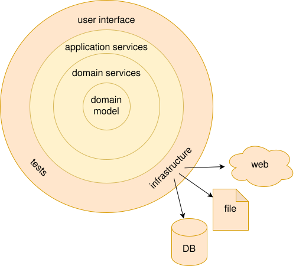
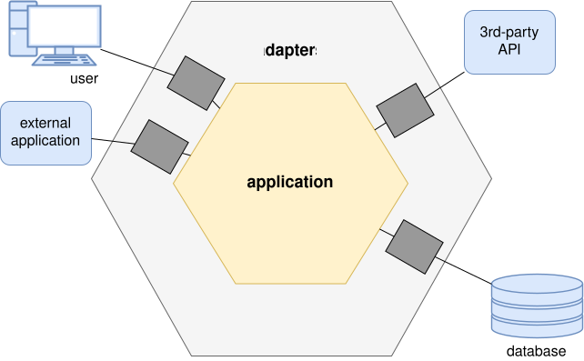

# software design and architecture stack

![based on Khalil Stemmel's figure [@stemmler2019how]](figures/the_software_design_and_architecture_stack_generalized.drawio.svg){height=475}

# gang of four (GoF) design patterns

- GoF: Erich Gamma, Richard Helm, Ralph Johnson, and John Vlissides
- 23 common software design patterns
    - published in "Design Patterns: Elements of Reusable Object-Oriented Software" (1994) [@gamma1994design]
- provides solutions to common design problems
- categorized into three main groups
    1. creational
    2. structural
    3. behavioral

::: {.text-smaller}
read about the design patterns in details, for example at [refactoring.guru](https://refactoring.guru/design-patterns/catalog)
:::

## GoF design patterns in functional programming

| OO pattern        | FP pattern |
|-------------------|------------|
| factory pattern   | function   |
| strategy pattern  | function   |
| decorator pattern | function   |
| visitor pattern   | function   |
| ...               | ...        |

Peter Norvig [demonstrated](http://www.norvig.com/design-patterns/) that 16 out of the 23 patterns are simplified or eliminated by language features in Lisp or Dylan (1998) [@norvig1998design]

[more about](https://fsharpforfunandprofit.com/fppatterns/) it from Scott Wlaschin [@wlaschin2014functional]

# SOLID principles

[SOLID is a mnemonic acronym for five design principles intended to make object-oriented designs more understandable, flexible, and maintainable [@enwiki:1237710587]]{.text-smaller}

single responsibility principle
~ [a class should do one thing and therefore it should have only a single reason to change]{.text-smaller}

open-closed principle
~ [classes should be open for extension and closed to modification]{.text-smaller}

Liskov substitution principle
~ [if class A is a subtype of class B, B should be able to replaced with A without disrupting the behavior of the program &rarr; [square/rectangle problem]{.background-color-lightblue}]{.text-smaller}

interface segregation principle
~ [many client-specific interfaces are better than one general-purpose interface; clients should not be forced to implement a function they do no need]{.text-smaller}

dependency inversion principle
~ [modules should depend upon interfaces or abstract classes, not concrete classes; it's an inversion because implementations depend upon abstractions and not the other way round]{.text-smaller}

::: {.text-smaller}
based on [@millington2019solid], [@oloruntoba2024solid]
:::

# coupling

:::::::::::: {.columns}
::::::::: {.column width="55%" .mt-5}
- the degree of interdependence between software modules
- coupling is usually contrasted with cohesion
    - low coupling often correlates with high cohesion, and vice versa
:::::::::
::::::::: {.column width="45%"}
 | public domain](figures/borrowed/CouplingVsCohesion.svg)
:::::::::
::::::::::::

::: {.text-smaller .mt-2}
source [Wikipedia](https://en.wikipedia.org/wiki/Coupling_(computer_programming)) [@enwiki:1245630908]
:::

# architectural styles / topologies

:::::::::::: {.columns}
::::::::: {.column width="33%"}
{width=250}

{width=250}

:::::::::
::::::::: {.column width="33%"}
{width=200}

:::::::::
::::::::: {.column width="33%"}
{width=250}

{width=250}

:::::::::
::::::::::::

# common pitfalls of architecture design and how to avoid them

tight coupling between layers

~ - use techniques like inversion of control for flexible dependency management
~ - each layer should only interacts with its adjacent layer through well-defined interfaces

too many layers

~ - define the essential layers based on your application requirements; 4&#8209;5&nbsp;layers are usually enough 
~ - avoid splitting responsibilities into too many small layers without reason

::: {.text-smaller}
source: [Layers in software architecture](https://medium.com/@sagar.hudge/layers-in-software-architecture-c8cc16329ff6) by Sagar Hudge [@hudge2024layers]
:::

## common pitfalls of architecture design and how to avoid them

cross-layer communication 

~ - violates the separation of concerns
~ - each layer only interacts with its adjacent layers (see [law of Demeter]{.tooltip title="An object should only interact with its immediate friends, not strangers."})

mixing business logic in the presentation layer

~ - happens when business rules implemented directly in the presentation layer resulting duplicated or inconsistent logic, which is harder to update, scale, or test
~ - keep business logic in the business logic layer and presentation layer should only display data/status updates

::: {.text-smaller}
source: [Layers in software architecture](https://medium.com/@sagar.hudge/layers-in-software-architecture-c8cc16329ff6) by Sagar Hudge [@hudge2024layers]
:::

## common pitfalls of architecture design and how to avoid them

failure to refactor and maintain the architecture

~ - "over time, the architecture may become outdated or cluttered with technical debt, making it hard to scale or add new features" [@hudge2024layers]
~ - regularly review and refactor the codebase to keep layers clean and maintainable -- iterative design, [boys scout rule]{.tooltip title="Leave the code cleaner than you found it."}

lack of proper layer abstraction

~ - "if layers are not abstracted properly (e.g., exposing internal implementation details), it becomes difficult to replace or update components without affecting other layers" [@hudge2024layers]
~ - each layer should have a clear interface that hides internal details from other layers

::: {.text-smaller}
source: [Layers in software architecture](https://medium.com/@sagar.hudge/layers-in-software-architecture-c8cc16329ff6) by Sagar Hudge [@hudge2024layers]
:::

# law of leaky abstractions

> All non-trivial abstractions, to some degree, are leaky.
>
> -- Joel Spolsky

:::::::::::: {.columns}
::::::::: {.column width="80%"}
- refers to a design flaw where an abstraction, intended to simplify and hide the underlying complexity of a system, fails to completely do so
- this results in some of the implementation details becoming exposed or 'leaking' through the abstraction,
- forcing users to have knowledge of these underlying complexities to effectively use or troubleshoot the system

:::::::::
::::::::: {.column width="20%" .mt-2}

:::::::::
::::::::::::

::: {.text-smaller}
source: Wikipedia / [Leaky abstraction](https://en.wikipedia.org/wiki/Leaky_abstraction) [@enwiki:1314409362]
:::

# references

::: {#refs}
:::
